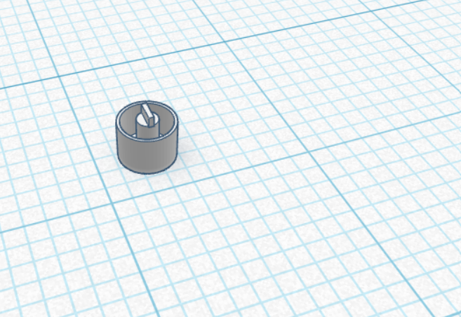
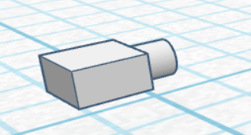
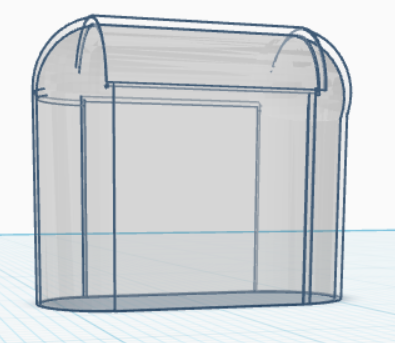

# StudyBuddy

WHAT IS IT :
It is an ambient light and timer made for students to help them study/focus while studying

WHY I AM MAKING IT :
I want a device that can make getting into the zone while studying feel less daunting for students and I want StudyBuddy to be that tool... It's just a light up timer, but I like it

